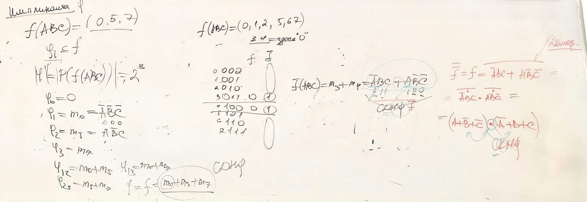

# Булевы функции, импликанты и нормальные формы

**Дата занятия:** 20.10.2026 — дата подтверждена Данилом.

## Конспект

### 1. Обозначения и нумерация наборов

Булева функция принимает аргументы и значения из множества $\lbrace 0,1\rbrace$. Для трёх переменных имеется восемь наборов. В порядке $A,B,C$ их номера задаются двоичной записью:

```math
i=4A+2B+C.
```

Например, $000$ — набор №0, $101$ — №5, $111$ — №7. Переменная $A$ соответствует старшему разряду.

В этой лекции используются обозначения булевой алгебры:

| Запись | Операция | Пример |
|---|---|---|
| $x+y$ | Дизъюнкция, «ИЛИ» | $1+1=1$ |
| $xy$ | Конъюнкция, «И» | $1\cdot 0=0$ |
| $\overline{x}$ | Отрицание | $\overline{0}=1$ |

В формуле сначала выполняется отрицание, затем конъюнкция, затем дизъюнкция.

Пусть $T_f$ — множество номеров наборов, на которых функция равна единице. Тогда запись $T_f=\lbrace 0,5,7\rbrace$ означает, что $f=1$ ровно на этих трёх наборах. Её столбец значений в порядке от №0 до №7: $(1,0,0,0,0,1,0,1)$.

> **Обратите внимание.** Знак «+» здесь означает «ИЛИ», а не обычное сложение и не сложение по модулю 2. Список $(0,5,7)$ в записи лекции — номера единичных наборов, а не столбец значений функции.

### 2. Почему дополнение единственно

Дополнение элемента $x$ — такой элемент $\overline{x}$, что одновременно выполняются два равенства:

```math
x+\overline{x}=1,\qquad x\overline{x}=0.
```

Докажем, что другого дополнения нет. Пусть $y$ также удовлетворяет $x+y=1$ и $xy=0$. Раскроем произведения по дистрибутивности:

```math
\begin{aligned}
y&=y\cdot 1=y(x+\overline{x})=yx+y\overline{x}
  =y\overline{x},\\
\overline{x}&=\overline{x}\cdot 1=\overline{x}(x+y)
  =\overline{x}x+\overline{x}y=\overline{x}y.
\end{aligned}
```

Правые части равны по коммутативности конъюнкции, поэтому $y=\overline{x}$. Так доказана **единственность дополнения** в булевой алгебре.

> **Обратите внимание.** Нужно проверить оба условия дополнения. Одно равенство $x+y=1$ ещё не определяет $y$ однозначно: при $x=1$ оно выполняется и для $y=0$, и для $y=1$.

### 3. Импликанты и множество единичных наборов

В обозначениях этой лекции функция $\varphi$ является **импликантой функции** $f$, если из $\varphi=1$ всегда следует $f=1$:

```math
\varphi\le f
\quad\Longleftrightarrow\quad
\forall\alpha\;\bigl(\varphi(\alpha)=1\Rightarrow f(\alpha)=1\bigr)
\quad\Longleftrightarrow\quad
T_{\varphi}\subseteq T_f.
```

То есть импликанта может покрывать часть единиц функции, но не должна захватывать её нули.

Для $T_f=\lbrace 0,5,7\rbrace$ введём конъюнкции, равные единице на одном наборе:

```math
m_0=\overline{A}\,\overline{B}\,\overline{C},\qquad
m_5=A\overline{B}C,\qquad
m_7=ABC.
```

Любое подмножество $T_f$ задаёт подходящую функцию $\varphi$. Получаются восемь вариантов:

| Единичные наборы импликанты | Функция $\varphi$ |
|---|---|
| $\varnothing$ | $0$ |
| $\lbrace 0\rbrace$ | $m_0$ |
| $\lbrace 5\rbrace$ | $m_5$ |
| $\lbrace 7\rbrace$ | $m_7$ |
| $\lbrace 0,5\rbrace$ | $m_0+m_5$ |
| $\lbrace 0,7\rbrace$ | $m_0+m_7$ |
| $\lbrace 5,7\rbrace$ | $m_5+m_7$ |
| $\lbrace 0,5,7\rbrace$ | $m_0+m_5+m_7=f$ |

Если у $f$ имеется $k$ единичных наборов, число таких **функций** равно $2^k$: каждый единичный набор можно независимо включить в $T_{\varphi}$ или исключить. Здесь $k=3$, поэтому $2^3=8$.

Например, $AC$ — импликанта этой функции: она равна единице только на №5 и №7. А $A$ не является импликантой: она дополнительно равна единице на №4 и №6, где $f=0$.

> **Обратите внимание.** В этом подсчёте импликанта — произвольная функция $\varphi\le f$, включая $0$ и $f$. Если рассматриваются только импликанты в виде отдельных элементарных конъюнкций, формула $2^k$ не подсчитывает их количество. Не путай число функций с числом разных формул, которые могут задавать одну функцию.

### 4. ДНФ, минтермы и СДНФ

**Литерал** — переменная или её отрицание. Элементарная конъюнкция — произведение литералов; после упрощения в ней нет повторов и одновременно переменной с её отрицанием.

**Дизъюнктивная нормальная форма (ДНФ)** — дизъюнкция элементарных конъюнкций. В отдельной конъюнкции могут присутствовать не все переменные функции.

**Минтерм** $m_i$ содержит каждую переменную ровно один раз и равен единице только на наборе №$i$. Чтобы построить минтерм:

- для разряда 1 бери переменную без отрицания;
- для разряда 0 бери её отрицание;
- соедини все литералы конъюнкцией.

Поэтому для набора $011$ получаем $m_3=\overline{A}BC$, а для $100$ — $m_4=A\overline{B}\,\overline{C}$.

**Совершенная ДНФ (СДНФ)** — дизъюнкция всех минтермов, соответствующих единичным наборам функции, без повторов. Для первого примера:

```math
\begin{aligned}
T_f&=\lbrace 0,5,7\rbrace,\\
f&=m_0+m_5+m_7\\
 &=\overline{A}\,\overline{B}\,\overline{C}
   +A\overline{B}C+ABC.
\end{aligned}
```

Почему это работает: на каждом единичном наборе свой минтерм равен 1, а все остальные равны 0. На нулевом наборе все выбранные минтермы равны 0.

> **Обратите внимание.** СДНФ полностью описывает таблицу функции, но обычно не является самой короткой формулой. После сокращения формула может остаться ДНФ и перестать быть совершенной.

### 5. СКНФ по нулям функции и через отрицание

**Конъюнктивная нормальная форма (КНФ)** — конъюнкция элементарных дизъюнкций. Совершенная КНФ состоит из **макстермов**: каждый содержит все переменные и равен нулю ровно на одном наборе.

Для построения макстерма $M_i$ правило противоположно правилу минтерма:

- для разряда 0 бери переменную без отрицания;
- для разряда 1 бери её отрицание;
- соедини литералы дизъюнкцией.

Рассмотрим второй пример, обозначив его $g$, чтобы не смешивать с предыдущим:

```math
T_g=\lbrace 0,1,2,5,6,7\rbrace.
```

Единственные нулевые наборы — №3 и №4.

| № | $A$ | $B$ | $C$ | $g$ | $\overline{g}$ |
|---|---|---|---|---|---|
| 0 | 0 | 0 | 0 | 1 | 0 |
| 1 | 0 | 0 | 1 | 1 | 0 |
| 2 | 0 | 1 | 0 | 1 | 0 |
| 3 | 0 | 1 | 1 | 0 | 1 |
| 4 | 1 | 0 | 0 | 0 | 1 |
| 5 | 1 | 0 | 1 | 1 | 0 |
| 6 | 1 | 1 | 0 | 1 | 0 |
| 7 | 1 | 1 | 1 | 1 | 0 |

Макстермы для этих двух нулевых наборов:

```math
M_3=A+\overline{B}+\overline{C},\qquad
M_4=\overline{A}+B+C.
```

При $011$ все три литерала $M_3$ равны нулю. На любом другом наборе хотя бы один из них равен единице. Аналогично $M_4$ обращается в нуль только на $100$. Поэтому СКНФ имеет вид:

```math
g=M_3M_4
 =(A+\overline{B}+\overline{C})(\overline{A}+B+C).
```

Тот же результат получается через СДНФ отрицания и **законы де Моргана**:

```math
\overline{u+v}=\overline{u}\,\overline{v},\qquad
\overline{uv}=\overline{u}+\overline{v}.
```

У $\overline{g}$ единицы стоят на №3 и №4, следовательно:

```math
\begin{aligned}
\overline{g}&=m_3+m_4=\overline{A}BC+A\overline{B}\,\overline{C},\\
g&=\overline{\overline{A}BC+A\overline{B}\,\overline{C}}\\
 &=\overline{\overline{A}BC}\cdot\overline{A\overline{B}\,\overline{C}}\\
 &=(A+\overline{B}+\overline{C})(\overline{A}+B+C).
\end{aligned}
```



*Фото 1 · 20.10.2026 — Импликанты первого примера слева; СДНФ отрицания и СКНФ второго примера в центре и справа.*

> **Обратите внимание.** СДНФ строится по единицам, СКНФ — по нулям. В минтерме литералы на выбранном наборе равны 1; в макстерме — 0. СДНФ $\overline{g}$ и СКНФ $g$ задают разные функции, связанные отрицанием.

### 6. Как превратить обычную ДНФ в совершенную

Если в конъюнкции нет переменной, домножь её на тождественную единицу. Например, при отсутствии $C$:

```math
A\overline{B}=A\overline{B}(C+\overline{C})
             =A\overline{B}C+A\overline{B}\,\overline{C}.
```

В примере с двумя неполными конъюнкциями дополним каждую недостающей переменной:

```math
\begin{aligned}
q&=A\overline{B}+\overline{B}\,\overline{C}\\
 &=A\overline{B}(C+\overline{C})
   +\overline{B}\,\overline{C}(A+\overline{A})\\
 &=A\overline{B}C+A\overline{B}\,\overline{C}
   +A\overline{B}\,\overline{C}
   +\overline{A}\,\overline{B}\,\overline{C}\\
 &=m_0+m_4+m_5.
\end{aligned}
```

Одинаковые минтермы объединяются по закону $x+x=x$. После этого в СДНФ каждый присутствует один раз.

Для КНФ действует двойственное преобразование. Если в дизъюнкции $D$ отсутствует $x$, то:

```math
D=(D+x)(D+\overline{x}).
```

Здесь правая часть равна $D+x\overline{x}=D$. Так в каждую скобку можно последовательно ввести все недостающие переменные.

### 7. Разложение по переменной и единственность СДНФ

Булеву функцию можно разложить по любой переменной. Для $A_1$:

```math
f(A_1,\ldots,A_n)
=A_1f(1,A_2,\ldots,A_n)
 +\overline{A_1}f(0,A_2,\ldots,A_n).
```

Функции с зафиксированным аргументом $f(1,\ldots)$ и $f(0,\ldots)$ называют **кофакторами** по этой переменной.

Проверка формулы состоит из двух случаев:

- при $A_1=1$ первое слагаемое равно $f(1,A_2,\ldots,A_n)$, второе — нулю;
- при $A_1=0$ первое слагаемое равно нулю, второе — $f(0,A_2,\ldots,A_n)$.

Значит, правая часть всегда совпадает с исходной функцией. Это **разложение Шеннона** в дизъюнктивной форме.

Если повторить разложение по всем переменным, получим:

```math
f(A_1,\ldots,A_n)
=\bigvee_{\alpha\in\lbrace 0,1\rbrace^n}
  \bigl(f(\alpha)\land m_{\alpha}(A_1,\ldots,A_n)\bigr).
```

Здесь $\alpha$ — конкретный двоичный набор, а $m_{\alpha}$ — минтерм этого набора. Коэффициент $f(\alpha)$ равен 0 или 1: при нуле слагаемое исчезает, при единице остаётся минтерм. Так получается СДНФ.

**Почему СДНФ единственна.** Зафиксируем список переменных. На наборе $\alpha$ только минтерм $m_{\alpha}$ равен единице. Если $f(\alpha)=1$, он обязан присутствовать; если $f(\alpha)=0$, он не может присутствовать. Поэтому набор минтермов определяется таблицей однозначно, с точностью до порядка записи.

> **Обратите внимание.** Для постоянной функции $0$ удобно считать СДНФ пустой дизъюнкцией, равной 0; для постоянной $1$ СКНФ — пустой конъюнкцией, равной 1. Если разрешены только непустые нормальные формы, эти два случая оговаривают отдельно. Обычная ДНФ, в отличие от совершенной, не обязана быть единственной.

### 8. Начало минимизации: существенные и фиктивные переменные

Переменная **существенна**, если существует пара наборов, различающихся только ею, на которых функция принимает разные значения. Переменная **фиктивна**, если её изменение никогда не меняет значение функции.

Для переменной $A$ это можно записать через кофакторы:

```math
\begin{aligned}
A\text{ фиктивна}&\quad\Longleftrightarrow\quad f(0,B,C)=f(1,B,C)
\text{ при всех }B,C,\\
A\text{ существенна}&\quad\Longleftrightarrow\quad
\exists B,C:\ f(0,B,C)\ne f(1,B,C).
\end{aligned}
```

В примере из записи единицы функции $h$ стоят на №3, №4 и №5:

| № | $A$ | $B$ | $C$ | $h$ |
|---|---|---|---|---|
| 0 | 0 | 0 | 0 | 0 |
| 1 | 0 | 0 | 1 | 0 |
| 2 | 0 | 1 | 0 | 0 |
| 3 | 0 | 1 | 1 | 1 |
| 4 | 1 | 0 | 0 | 1 |
| 5 | 1 | 0 | 1 | 1 |
| 6 | 1 | 1 | 0 | 0 |
| 7 | 1 | 1 | 1 | 0 |

Сравним по одной подходящей паре для каждой переменной:

- **$A$ существенна:** №3 $(011)$ и №7 $(111)$, значения 1 и 0.
- **$B$ существенна:** №4 $(100)$ и №6 $(110)$, значения 1 и 0.
- **$C$ существенна:** №2 $(010)$ и №3 $(011)$, значения 0 и 1.

Следовательно, у $h$ нет фиктивных переменных. При этом её формулу можно сократить:

```math
\begin{aligned}
h&=\overline{A}BC+A\overline{B}\,\overline{C}+A\overline{B}C\\
 &=\overline{A}BC+A\overline{B}(\overline{C}+C)\\
 &=\overline{A}BC+A\overline{B}.
\end{aligned}
```

Склеились минтермы №4 и №5, которые отличаются только значением $C$. В полученной ДНФ пять вхождений литералов вместо девяти, но функция по-прежнему существенно зависит от всех трёх переменных. Это корректное сокращение; доказательство глобальной минимальности требует выбранного критерия сложности и отдельного обоснования.

Для сравнения: у функции $p(A,B,C)=A+B$ переменная $C$ фиктивна. Её можно исключить из списка аргументов без изменения правила вычисления значения.

> **Обратите внимание.** При проверке существенности сравнивай наборы, различающиеся ровно одной переменной. Совпадение значений на одной паре ещё не доказывает фиктивность. Минимизация формулы может сокращать число операций и вхождений литералов; убрать существенную переменную из эквивалентной формулы нельзя.

## Вопросы для самопроверки

### 1. Что означает запись единичных наборов (0, 5, 7) при порядке переменных A, B, C?

<details>
<summary>Показать ответ</summary>

Функция равна 1 на $000$, $101$, $111$ и равна 0 на остальных наборах. Столбец значений: $(1,0,0,0,0,1,0,1)$. Номер набора вычисляется как $4A+2B+C$.

</details>

---

### 2. Какими двумя равенствами определяется дополнение и почему оно единственно?

<details>
<summary>Показать ответ</summary>

Нужны $x+\overline{x}=1$ и $x\overline{x}=0$. Если $y$ удовлетворяет тем же условиям, то $y=y(x+\overline{x})=y\overline{x}$ и $\overline{x}=\overline{x}(x+y)=\overline{x}y$, следовательно, $y=\overline{x}$.

</details>

---

### 3. Как проверить, что функция φ является импликантой f?

<details>
<summary>Показать ответ</summary>

На каждом наборе с $\varphi=1$ должно выполняться $f=1$. Эквивалентно $T_{\varphi}\subseteq T_f$. Чтобы опровергнуть свойство, достаточно одного набора с $\varphi=1$, $f=0$.

</details>

---

### 4. Почему для трёх единичных наборов получилось восемь импликант?

<details>
<summary>Показать ответ</summary>

Рассматривались все функции $\varphi\le f$, включая 0. Каждой соответствует подмножество трёх единичных наборов, а таких подмножеств $2^3=8$. Это не подсчёт только элементарных конъюнкций.

</details>

---

### 5. Почему AC является импликантой первого примера, а A — нет?

<details>
<summary>Показать ответ</summary>

$AC=1$ только на №5 и №7 — оба набора единичные для $f$. Но $A=1$ также на №4 и №6, где $f=0$.

</details>

---

### 6. Построй минтерм и макстерм для набора 101.

<details>
<summary>Показать ответ</summary>

Минтерм $m_5=A\overline{B}C$: равен 1 только на $101$. Макстерм $M_5=\overline{A}+B+\overline{C}$: равен 0 только на $101$. Правила отрицаний противоположны.

</details>

---

### 7. Как записать СДНФ функции с единицами на №0, №5, №7?

<details>
<summary>Показать ответ</summary>

```math
f=m_0+m_5+m_7
 =\overline{A}\,\overline{B}\,\overline{C}+A\overline{B}C+ABC.
```

</details>

---

### 8. Как записать СКНФ функции с нулями на №3 и №4?

<details>
<summary>Показать ответ</summary>

```math
g=M_3M_4=(A+\overline{B}+\overline{C})(\overline{A}+B+C).
```

Каждая скобка равна нулю на соответствующем нулевом наборе. Тот же результат получается отрицанием СДНФ $\overline{g}$ по законам де Моргана.

</details>

---

### 9. Как ввести недостающую переменную в ДНФ и КНФ?

<details>
<summary>Показать ответ</summary>

Для конъюнкции $K$, не содержащей $x$: $K=K(x+\overline{x})=Kx+K\overline{x}$. Для дизъюнкции $D$, не содержащей $x$: $D=(D+x)(D+\overline{x})$. Затем повторяют для остальных недостающих переменных и убирают дубликаты.

</details>

---

### 10. Сформулируй разложение по переменной и объясни его проверку.

<details>
<summary>Показать ответ</summary>

```math
f(A,B,C)=Af(1,B,C)+\overline{A}f(0,B,C).
```

При $A=1$ остаётся первое слагаемое, при $A=0$ — второе. Последовательное разложение по всем переменным даёт СДНФ; единичные наборы однозначно определяют её минтермы.

</details>

---

### 11. В примере h значения на №3 и №7 различаются. Какая переменная существенна?

<details>
<summary>Показать ответ</summary>

№3 — $011$, №7 — $111$. Меняется только $A$, поэтому различие значений доказывает существенность $A$. Для фиктивности понадобилось бы равенство значений на всех парах, различающихся только этой переменной.

</details>

---

### 12. Почему склеивание минтермов №4 и №5 не делает C фиктивной во всей функции h?

<details>
<summary>Показать ответ</summary>

В этой паре $A\overline{B}\,\overline{C}+A\overline{B}C=A\overline{B}$, но в оставшемся слагаемом $\overline{A}BC$ переменная $C$ сохраняется. На №2 $(010)$ и №3 $(011)$ значения $h$ различаются, поэтому $C$ существенна. Сокращение числа вхождений переменной не означает исчезновение зависимости от неё.

</details>

## Самое важное — теоретический минимум

- Дополнение: $x+\overline{x}=1$, $x\overline{x}=0$; оно единственно.
- Импликанта: $\varphi\le f$, то есть $T_{\varphi}\subseteq T_f$.
- СДНФ — дизъюнкция минтермов единичных наборов; СКНФ — конъюнкция макстермов нулевых наборов.
- Разложение: $f=Af(1,\ldots)+\overline{A}f(0,\ldots)$.
- Существенная переменная меняет значение хотя бы на одной паре наборов, различающихся только ею; фиктивная — ни на одной.
